<div align="center">
  

  <p>
    <a href="https://yugamdeepgoyal.github.io"><b>Portfolio</b></a> &nbsp;|&nbsp;
    <a href="https://www.linkedin.com/in/your-username"><b>LinkedIn</b></a>
  </p>
</div>

I'm a second year BTech student in Artificial Intelligence and Data Science. I like taking a messy dataset and turning it into something that actually works, from the first look at the data to a model I can explain and a demo someone else can click. Right now I'm moving from sequence models toward Transformers.

<div align="center">
  
</div>

<p align="center"><sub>The card above rebuilds itself automatically from the GitHub API, so it is always current.</sub></p>

## Featured work

| Project | Problem | Approach | Highlight |
| - | - | - | - |
| [ecg_data](https://github.com/YugamdeepGoyal/ecg_data) | Detecting abnormal heartbeats in ECG signals | LSTM, Bi-LSTM and XGBoost compared side by side, built with TensorFlow and Keras | Live Streamlit demo |
| [predictive_maintenance](https://github.com/YugamdeepGoyal/predictive_maintenance) | Estimating the Remaining Useful Life of aircraft engines from NASA C-MAPSS data | XGBoost and LSTM models | Sequence modeling on engine degradation data |
| [mnist_dataset_model](https://github.com/YugamdeepGoyal/mnist_dataset_model) | Digit classification | Fully connected network tuned with a Keras Tuner Hyperband search | About 98.58% test accuracy, reproducible training pipeline, confusion matrix analysis |
| [exp_learning_telco_churn](https://github.com/YugamdeepGoyal/exp_learning_telco_churn) | Predicting telecom customer churn | Logistic Regression and Random Forest, plus an ANN pipeline | Classical ML and deep learning compared on one problem |
| [PremiumPulse](https://github.com/YugamdeepGoyal/PremiumPulse) | Predicting medical insurance charges | Ten regression models, from linear regression to XGBoost | Systematic hyperparameter tuning and reusable scikit-learn pipelines |
| [beyond_accuracy](https://github.com/YugamdeepGoyal/beyond_accuracy) | Predicting stroke risk from imbalanced patient data | Logistic regression with SMOTE oversampling | Classification threshold optimization |

## How I work

- **Compare, don't guess.** I try more than one model on the same problem, so the choice is backed by results and not by habit.
- **Look past accuracy.** Class imbalance, thresholds and error types matter more than one headline number.
- **Build pipelines, not one-off notebooks.** Reusable preprocessing and training steps make the work easy to rerun and easy to check.

## Where I am on the learning path

ANN, then CNN, RNN, LSTM, GRU, Encoder-Decoder and Attention. Now working through Transformers.

## Toolkit

| Layer | Tools |
| - | - |
| Data | pandas, NumPy, seaborn, matplotlib |
| Classical ML | scikit-learn, XGBoost |
| Deep learning | TensorFlow, Keras, Keras Tuner |
| Demos | Streamlit |
| Environment | Python, Jupyter Notebook |

## About me, as a class

```python
class Yugamdeep:
    def __init__(self):
        self.role = "AI and Data Science student, second year"
        self.focus = ["applied ML", "deep learning", "data analysis"]
        self.currently_learning = "Transformers"

    def what_i_do(self):
        return "Turn a messy dataset into a working, explainable pipeline"

print(Yugamdeep().what_i_do())
```
