<p align="center">
  
</p>

I'm a second year BTech student in Artificial Intelligence and Data Science. I like taking a messy dataset and turning it into a clean, working ML pipeline. Lately I've been going deeper into deep learning, and the picture above is the honest version of how that's going: the loss keeps coming down, with a few bumps along the way.

## Learning log

| Stage | Topic | Status |
| - | - | - |
| 1 | ANN | Done |
| 2 | CNN | Done |
| 3 | RNN | Done |
| 4 | LSTM | Done |
| 5 | GRU | Done |
| 6 | Encoder-Decoder | Done |
| 7 | Attention | Done |
| 8 | Transformers | In progress |

## Selected projects

| Project | What it does | Worth knowing |
| - | - | - |
| [mnist_dataset_model](https://github.com/YugamdeepGoyal/mnist_dataset_model) | Fully connected neural network for MNIST digit classification | Tuned with a Keras Tuner Hyperband search, about 98.58% test accuracy, with a reproducible training pipeline and confusion matrix analysis |
| [PremiumPulse](https://github.com/YugamdeepGoyal/PremiumPulse) | Predicts medical insurance charges | Ten regression models from linear regression to XGBoost, systematic hyperparameter tuning, reusable scikit-learn pipelines |
| [beyond_accuracy](https://github.com/YugamdeepGoyal/beyond_accuracy) | Predicts stroke risk from patient health data | Logistic regression with SMOTE oversampling for class imbalance, plus classification threshold optimization |
| [healthcare-dataset-eda](https://github.com/YugamdeepGoyal/healthcare-dataset-eda) | EDA and preprocessing on 20,000 patient records across 32 diseases | Structured missing data, ordinal encoding, multi-label symptom binarization |
| [titanic_prediction](https://github.com/YugamdeepGoyal/titanic_prediction) | Titanic survival prediction | Logistic regression and SVM inside scikit-learn pipelines |
| [Python_Data_Analysis_Project](https://github.com/YugamdeepGoyal/Python_Data_Analysis_Project) | Exploratory analysis of 7,668 IMDb movies from 1980 to 2020 | Python, pandas and seaborn |

## Toolkit

| Layer | Tools |
| - | - |
| Data | pandas, NumPy, seaborn, matplotlib |
| Classical ML | scikit-learn, XGBoost |
| Deep learning | TensorFlow, Keras, Keras Tuner |
| Environment | Python, Jupyter Notebook |

## About me, as a class

```python
class Yugamdeep:
    def __init__(self):
        self.role = "AI and Data Science student, second year"
        self.focus = ["applied ML", "data analysis", "deep learning"]
        self.already_learned = [
            "ANN", "CNN", "RNN", "LSTM", "GRU", "Encoder-Decoder", "Attention"
        ]
        self.currently_learning = "Transformers"

    def what_i_do(self):
        return "Turn a messy dataset into a clean, working pipeline"

me = Yugamdeep()
print(me.what_i_do())
```

## Known issues

- Still learning, so some of my models are more confident than they should be
- I will happily spend an evening on a loss curve that refuses to behave
- Open to feedback, especially on my pipelines and project structure

## Connect

[LinkedIn](https://www.linkedin.com/in/yugamdeep-goyal-bb765633a/)
